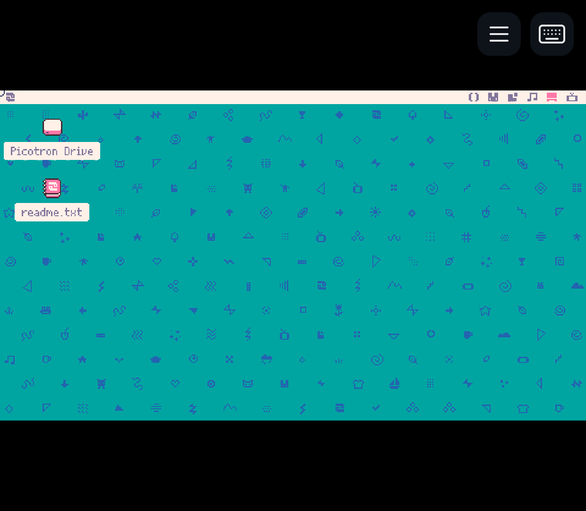
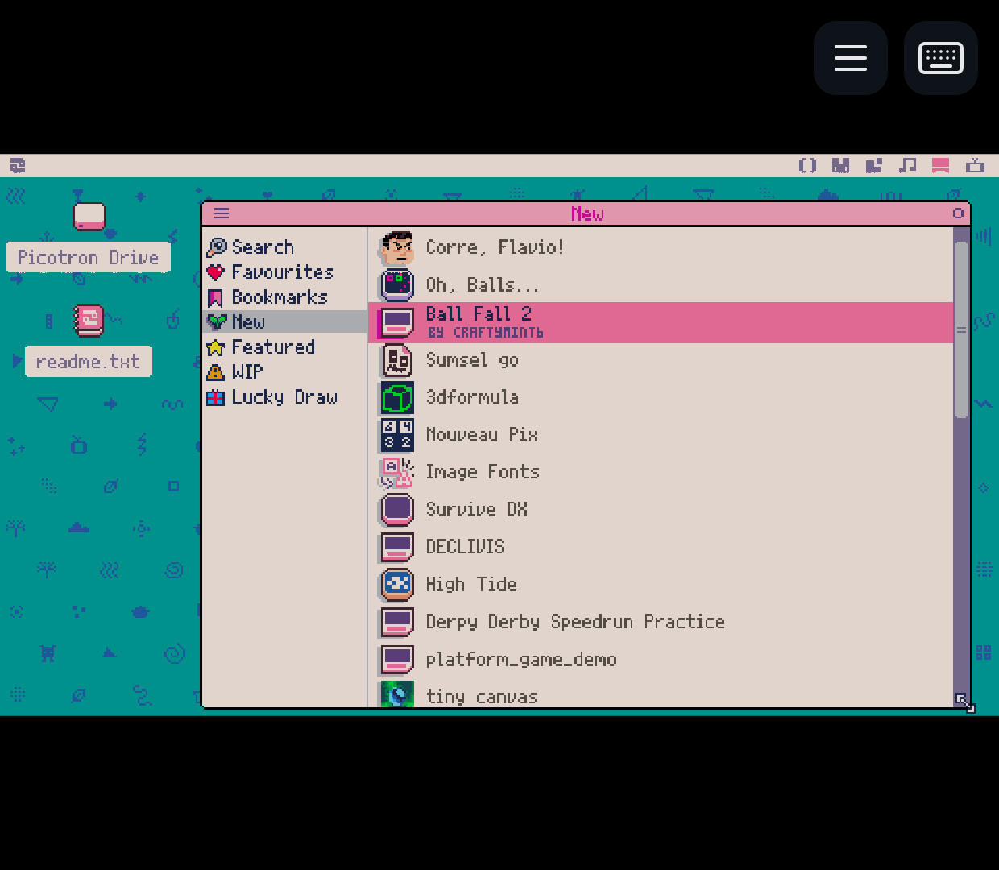
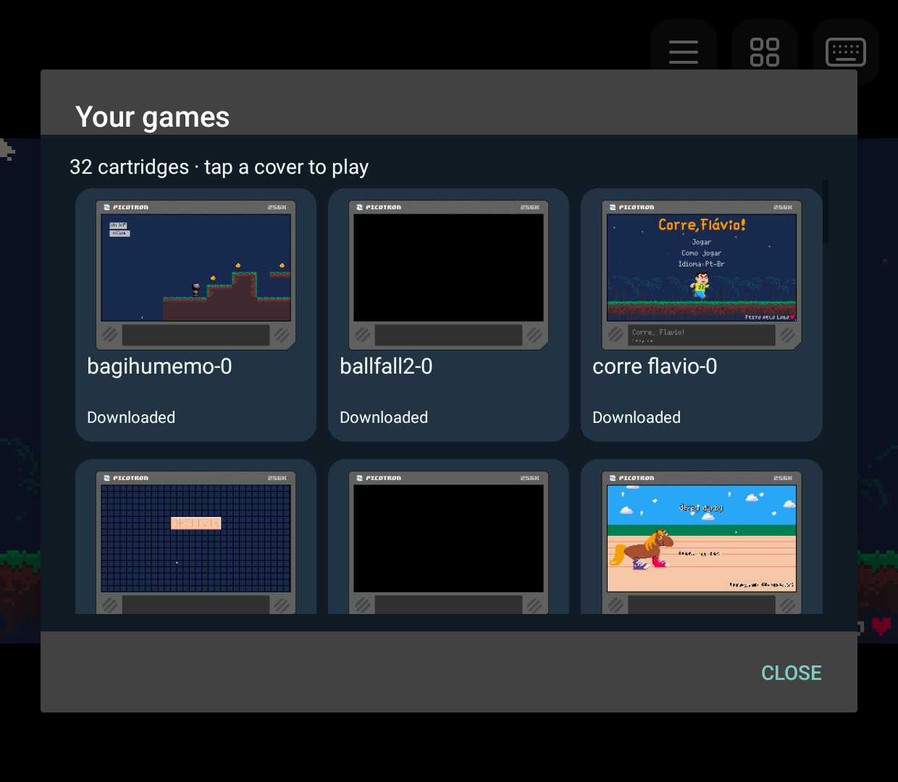
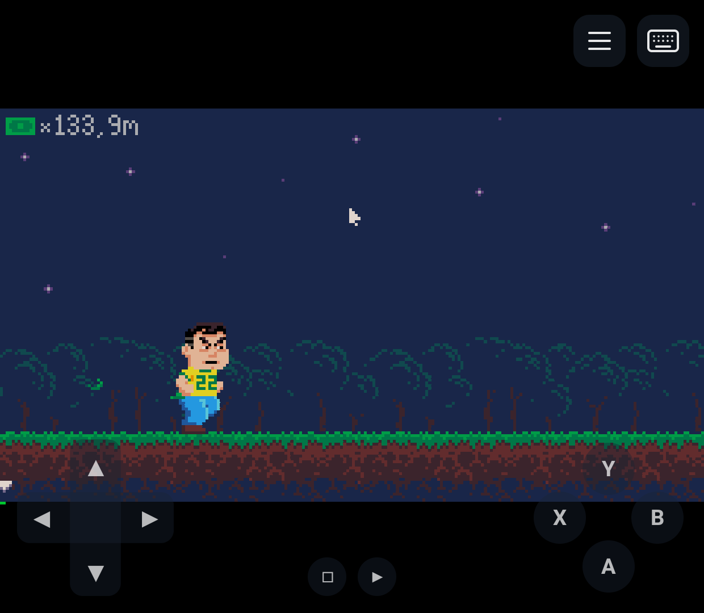
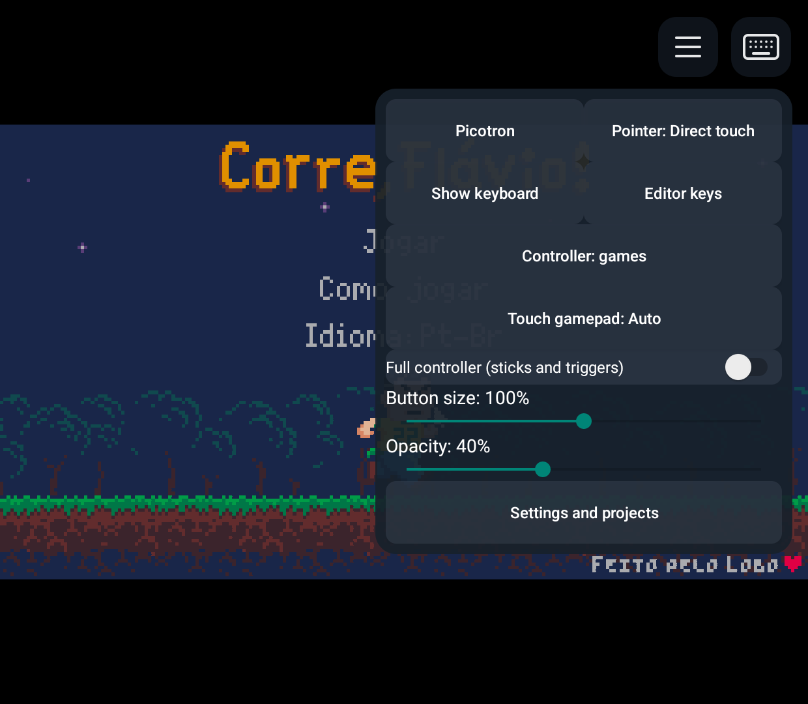
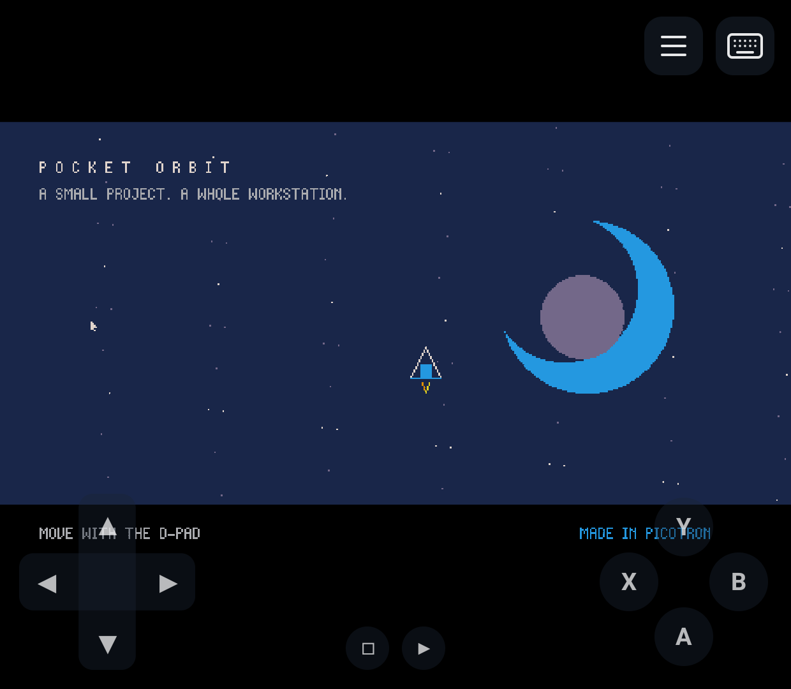
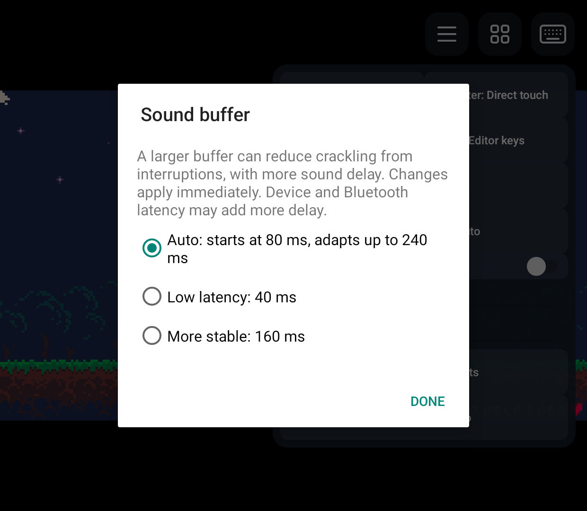

# PicotronNest

### Your pocket fantasy workstation.

Run the real **Picotron** on Android. Play, write code, draw sprites and pick up
your projects wherever you are.

**Bring your own Picotron. One app. No root or Termux.**

**[Download beta 4 for Android](https://github.com/EriArk/PicotronNest/releases/download/v0.1.0-beta.4/PicotronNest-0.1.0-beta.4-arm64.apk)** · [What's new](https://github.com/EriArk/PicotronNest/releases/tag/v0.1.0-beta.4)

[Screenshots](docs/screenshots/README.md) · [Getting started](#getting-started) · [Help](docs/USER_GUIDE.md) · [Report a problem](https://github.com/EriArk/PicotronNest/issues)

*The actual Picotron desktop on Android, captured on a Retroid Pocket Classic.*

## Create and play, in Picotron

Your familiar desktop, windows, code editor, graphics tools and cartridges are
all supplied by **your official Picotron copy**. PicotronNest brings the Android
controls, fullscreen display and a persistent home for your work.

- **Play:** find games in Splore and launch downloaded favourites from a cover grid.
- **Create:** use Picotron's own editors with touch, a mouse or an Android keyboard.
- **Keep your work:** return to the same home, import/export cartridges and back up
  projects through Android's file picker.

## Find your next game

Browse the real online Splore catalog. Then open **Your games** beside the
hamburger and tap a cover to play a downloaded or local cartridge.

| Discover in Splore | Your games, ready to launch |
| --- | --- |
|  |  |

## Play your way

Use a handheld gamepad, mouse and keyboard, or touchscreen controls. Choose a
compact layout or add sticks and triggers; adjust size and transparency, or hide
the controls. Auto hides them when a gamepad is connected.

| Play on the touchscreen | Tune the controls |
| --- | --- |
|  |  |

**Start** opens the game's pause menu; **Guide** opens PicotronNest controls.
The keyboard icon brings up Android's keyboard, and **Back** gives you a way out.

## Make it yours

Work on your own cartridges and keep your saves between sessions. Sound buffering
offers **Auto**, **Low latency** and **More stable**; larger buffers add sound delay.

| Your own projects | Sound buffer choices |
| --- | --- |
|  |  |

All screenshots are real Retroid captures. The gallery includes beta 1/2 screens
and the beta 3 launcher/audio controls. These earlier captures do not establish
beta 4 hardware acceptance. Open any image at full size or browse
the [gallery with credits and original PNGs](docs/screenshots/README.md).

## Getting started

**[Download beta 4 APK](https://github.com/EriArk/PicotronNest/releases/download/v0.1.0-beta.4/PicotronNest-0.1.0-beta.4-arm64.apk)**
or open the [release page](https://github.com/EriArk/PicotronNest/releases/tag/v0.1.0-beta.4)
for source archives, screenshots, notices and checksums.

To get started:

1. Install the PicotronNest APK on your Android device.
2. Get your own [Picotron copy from Lexaloffle](https://www.lexaloffle.com/picotron.php).
   Download the **Linux / Raspberry Pi 64-bit ARM64 ZIP**.
3. Open PicotronNest and follow the three-step setup wizard to select that ZIP.
4. Review the controls/save guidance and tap **Start Picotron**. After setup,
   opening the app takes you straight to Picotron.

**Picotron is not included.** Windows, macOS, 32-bit and PICO-8 packages cannot
be used. There is no separate helper app to install.

Since beta 3, imports accept compatible older/newer ARM64 runtime packages without a fixed
version allowlist. Device checks used 0.3.0d2; accepting an archive does not prove
every version works. See [onboarding and import evidence](docs/ONBOARDING.md).
Save and fully quit Picotron before updating. Install over an earlier beta to
preserve your runtime and projects; do not uninstall or clear data.

## Before you try the beta

Earlier scoped hardware checks used **Retroid Pocket Classic, Android 14**.
Beta 4 adds queued/folder imports, screenshots, restart and control improvements;
its fresh hardware upgrade/recovery cycle remains unverified. See the
[release limits](docs/releases/0.1.0-beta.4.md). A 64-bit
ARM Android device is required; other phones, tablets and handhelds still need
testing. The owner reported good Phoenix sound on Retroid after beta 3;
[phone listening, audio interruptions and longer sessions](docs/AUDIO_AND_LIBRARY.md#owner-listening-follow-up--2026-11-02)
still need confirmation. The friend's phone crackling report remains unresolved.

Splore catalog browsing, downloads and game launch have been checked on Retroid.
Accounts, uploads and different network setups still need tester confirmation.
Back up your Picotron home before uninstalling the app: Android removes its private files on uninstall.

Need help? Read the [user guide](docs/USER_GUIDE.md), or use the short
[tester checklist](docs/TESTING.md). You can export a report from **Settings and
projects → About and diagnostics** when reporting a problem.

## For contributors

[Build and release instructions](docs/RELEASING.md) · [Current status](docs/STATUS.md) ·
[Roadmap](docs/ROADMAP.md) · [Third-party notices](THIRD_PARTY_NOTICES.md)

Inspired by the separate [PikoNest](https://github.com/EriArk/PikoNest) project.
PicotronNest is an independent, unofficial project and is not affiliated with
Lexaloffle Games. Picotron belongs to Lexaloffle; its runtime files are never
included in this repository or the APK.
