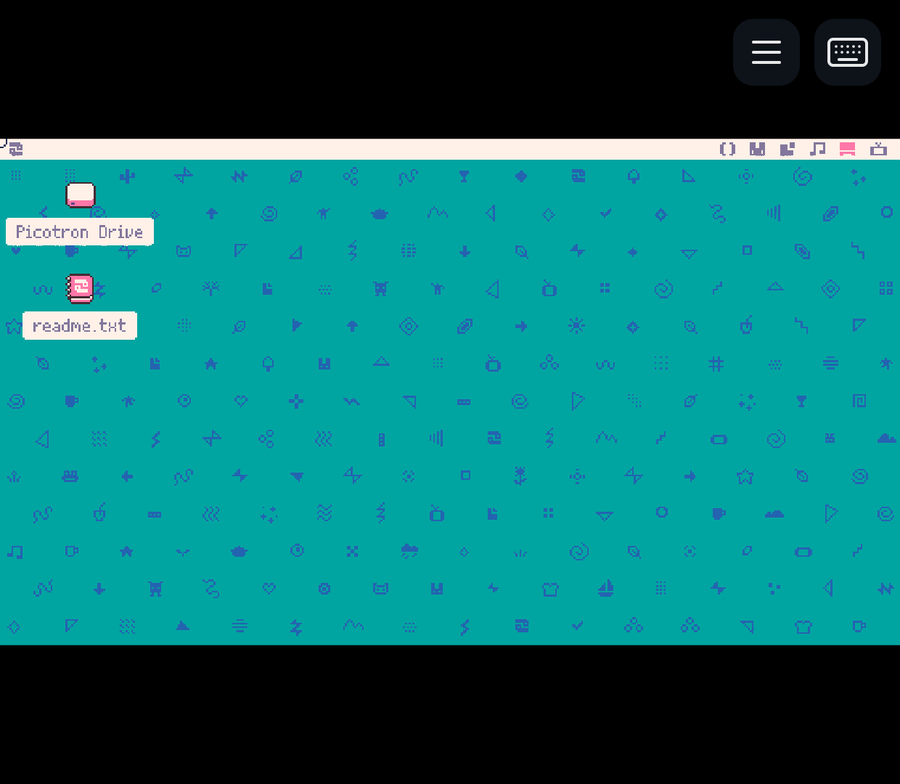
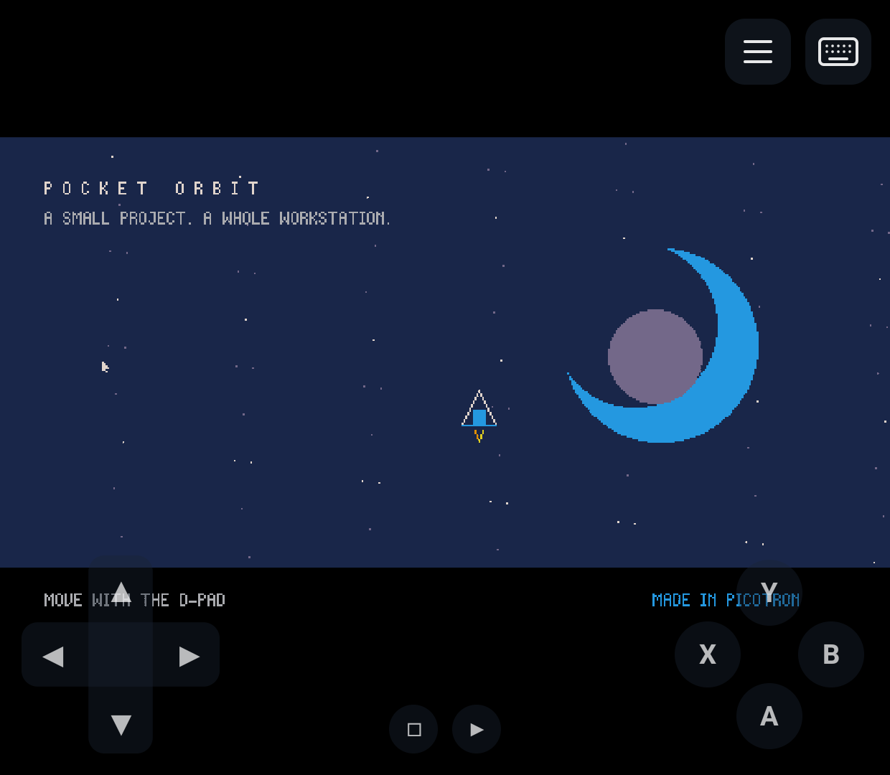
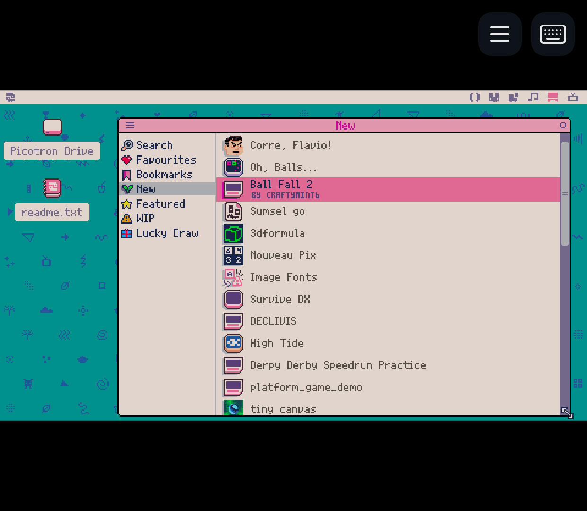
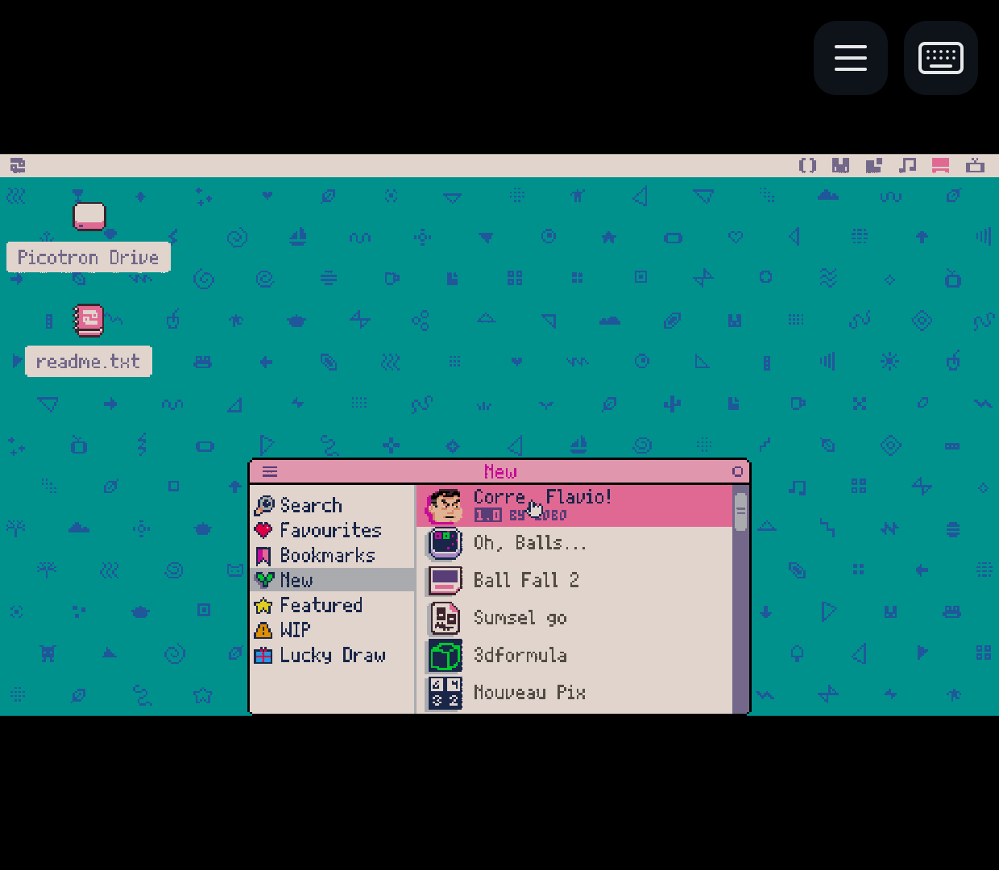
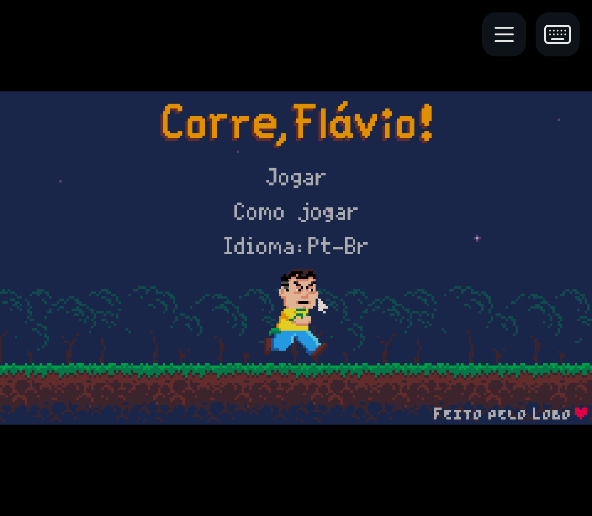
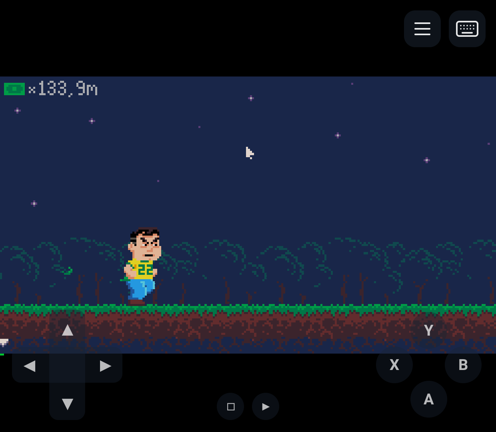
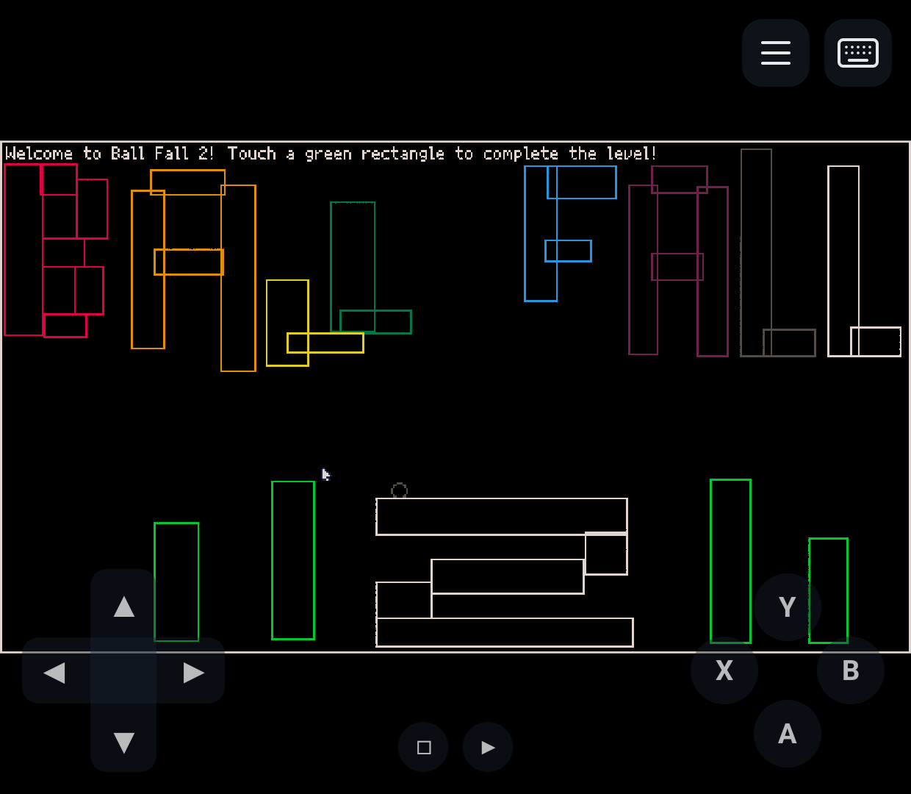
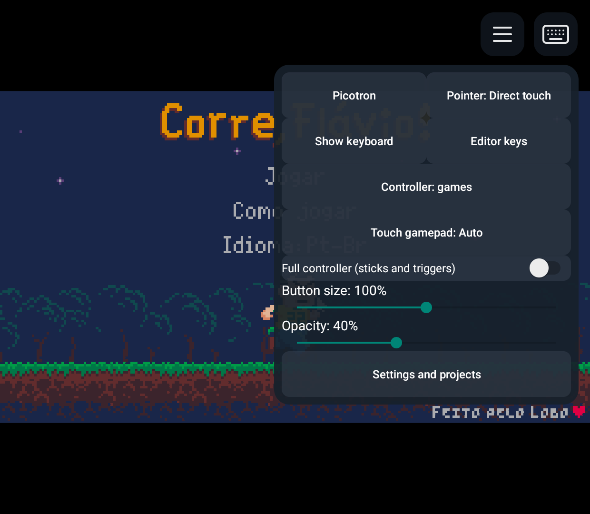
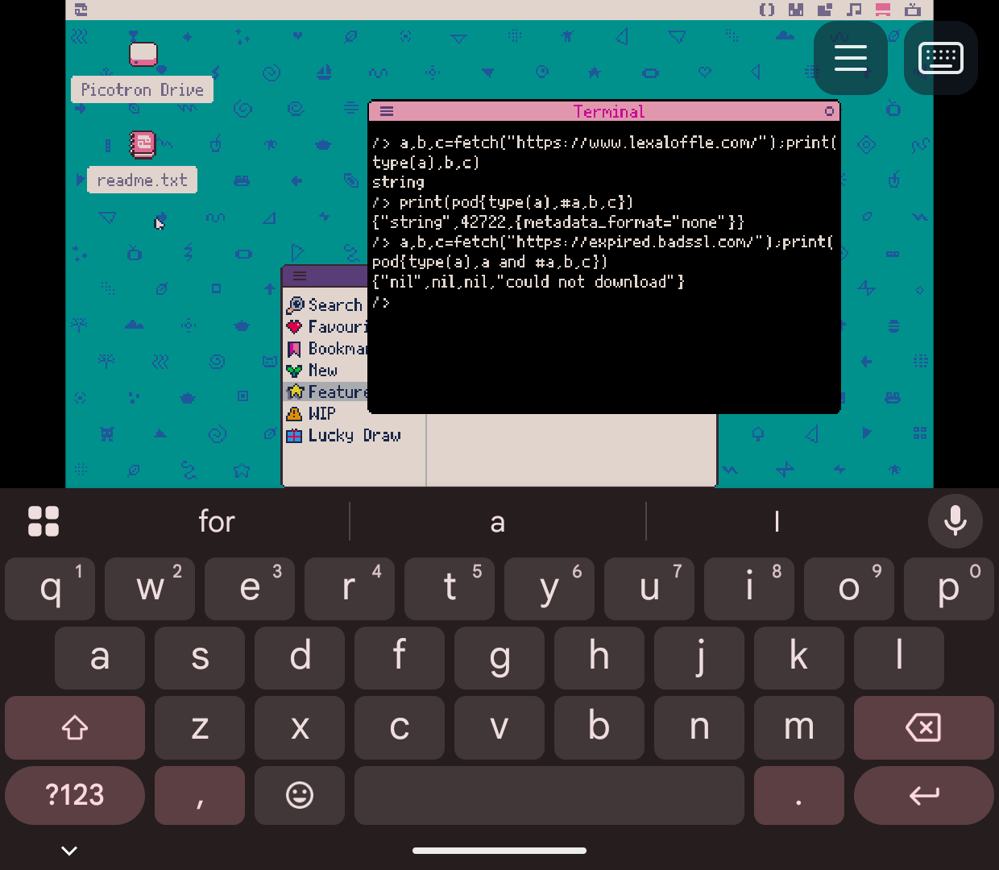

# Screenshots for articles and websites

Original **1240 x 1080 PNGs**, captured on **Retroid Pocket Classic / Android 14**
on 2026-11-02. Click any image for the full-size file. These are actual application
screens, with no cropping, retouching, compositing or generated content.

The [beta 2 release](https://github.com/EriArk/PicotronNest/releases/tag/v0.1.0-beta.2)
includes a `PicotronNest-0.1.0-beta.2-screenshots.zip`
containing this gallery and its original PNGs. The same images are also in the
repository source archive.

## Workstation and controls

| Official desktop | Touch controls |
| --- | --- |
|  |  |

`desktop.png` and `touch-controls.png` were captured in product **0.1.0-beta.1**.
The latter shows the project's asset-free [Pocket Orbit example](../../examples/pocket_orbit.lua),
after an injected touchscreen gesture moved the spacecraft.

## Splore and downloaded games

The following images were captured in product **0.1.0-beta.2**. The official
Picotron **0.3.0d2 Raspberry Pi 64-bit** runtime was imported by its owner.
The New catalog loaded online, and both depicted games were downloaded and
opened through native Splore. Ball Fall 2 was moved with the touch D-pad.

| Splore catalog | Splore desktop window |
| --- | --- |
|  |  |

| Corre, Flavio! title | Corre, Flavio! gameplay |
| --- | --- |
|  |  |

| Ball Fall 2 gameplay | Overlay settings |
| --- | --- |
|  |  |

## Technical verification

`network-https-check.png` records an HTTPS response from the official website and
an unsuccessful request to an expired-certificate test endpoint. It is a test
record, not a suggested storefront image. See [network evidence](../NETWORK.md).

## Credits and scope

Picotron, its desktop and editor artwork belong to **Lexaloffle**. The catalog
and game imagery belong to their respective creators: **LOBO** for *Corre, Flavio!*;
**CRAFTYMINT6** for *Ball Fall 2* (credits displayed in Splore). These screenshots
were included at the owner's explicit request for the README and website posts.
The project's MIT license covers original PicotronNest code; it does not relicense
Picotron or third-party game artwork. Keep game attribution when describing them.

No purchased archive, runtime binary/data file, private project or extracted
runtime source is included. Images establish the depicted visual states, not
general compatibility, long-session gameplay or audible sound acceptance.
